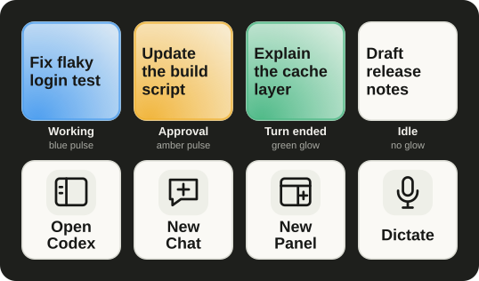

# Codex Sidekick

**Control the OpenAI Codex extension in VS Code from a Stream Deck Neo.** Glowing chat keys, one-press dictation, and your Codex usage at a glance.

<p align="center"></p>

## Features

- **Recent chats, any project.** Four keys show your latest local Codex chats across every project. Pressing one focuses that chat's editor tab when it is open.
- **A glow that follows Codex.** Blue pulse while Codex works, amber when it asks for approval, a brief green glow when a turn ends, coral when it is interrupted.
- **One-press dictation.** Press to record, press again to stop. Codex transcribes and leaves the draft unsent in the message box.
- **Open Codex, New Chat, New Panel** keys.
- **Usage on the Infobar.** Remaining five-hour and weekly allowance, plus the tokens of the latest request.
- **Private and local.** Nothing leaves your Mac, and Sidekick can never approve, deny or send anything.

<p align="center"></p>

## Requirements

- macOS 13 or later
- Stream Deck 7.6 or later, with a Stream Deck Neo
- Visual Studio Code with the official OpenAI Codex extension
- Node.js 22.18 or later (used by the activity hooks)

The prebuilt installers are for Apple silicon. On an Intel Mac, [build from source](#build-from-source).

## Install

1. Download `dev.sidekick.codex-<version>.streamDeckPlugin` and `codex-sidekick-neo-<version>.vsix` from the Releases page.
2. Double-click the `.streamDeckPlugin` file and confirm in Stream Deck.
3. In VS Code choose **Extensions → … → Install from VSIX…**, pick the `.vsix`, then reload the window.
4. Open a trusted local folder. Sidekick connects it and installs its hooks into `~/.codex/hooks.json` automatically. An existing hooks file is never overwritten; Sidekick offers a draft to merge instead.
5. In the Codex sidebar open **Codex Settings → Hooks**, then review and trust the eight Sidekick hooks. Send a message in any chat and its key starts to glow.
6. In the Stream Deck app, arrange the Neo: **Chat Activity 1–4** on the top row, **Open Codex**, **New Chat**, **New Panel** and **Dictate** below, and **Codex Usage** on the Infobar.
7. For dictation, enable **Elgato Stream Deck** under **System Settings → Privacy & Security → Accessibility**, and allow VS Code to use the microphone when macOS asks.

If you use several VS Code windows, only one can be connected at a time, because two connected windows disable the keys. Sidekick does not automatically connect a second window. Run **Codex Sidekick: Toggle Connection for This Workspace** in the window you want.

## Using it

| Key | What it does |
| --- | --- |
| Chat Activity 1–4 | Shows a recent chat and its status. Press to focus its editor tab, or to open the Codex sidebar if the chat isn't open in a tab. |
| Open Codex | Opens the Codex sidebar. |
| New Chat | Starts a new chat in the sidebar. |
| New Panel | Opens a Codex editor panel. |
| Dictate | Starts recording. Press again to stop and have Codex transcribe. |

**Reading the glow**

| Color | Meaning |
| --- | --- |
| Blue pulse | Codex has recently been working. |
| Amber pulse | Codex recently asked for approval. |
| Green glow | A turn just ended. |
| Coral | A turn was interrupted. |
| None | No recent activity. |

Colors are observations from Codex hooks, not live state, so they fade as they expire. Check Codex itself for the current state and for approvals.

## How dictation works

Codex has no public command for dictation, so Sidekick finds Codex's own microphone button through macOS Accessibility and clicks it. Codex still does the recording, transcribing and inserting. The helper acts only on a microphone inside a webview owned by the official Codex extension, in the connected workspace's window. With two Codex composers on screen it prefers the focused one, then the sidebar, and it confirms from the button's own label that recording started or stopped. It moves your pointer to the button for the click and puts it back. It never reads text fields, chat text or audio.

## Limitations

- **macOS only.** Dictation uses macOS Accessibility, and the bridge uses a local Unix socket.
- **Dictation depends on Codex's interface.** It finds the microphone by its accessibility label, so a Codex redesign can break it until Sidekick is updated. The helper refuses to act when it cannot identify exactly one Codex microphone.
- **Activity colors are observations, not live state.** They expire after a short time, and approval decisions always stay in Codex.
- **One connected VS Code window at a time.**
- **Chat selection is limited by Codex.** Codex exposes no command for choosing a sidebar chat, so a chat key focuses the matching editor tab when one is open and otherwise opens the sidebar.
- **Early release.** Tested on one Mac with one Neo.

## Privacy and security

Everything runs locally. The activity log records only event names, timestamps, hashed session IDs and token counts. It never records prompts, file paths or transcripts. The hooks run for every local Codex session on your Mac, including the CLI and desktop app. See [SECURITY.md](SECURITY.md) for what is stored, what the native helper can and cannot do, and how to report a vulnerability.

## Build from source

Requires macOS, Node.js 22.18 or later, and the Xcode command line tools.

```sh
npm ci
npm test              # typecheck, build, and the automated suite
npm run test:host     # optional: real VS Code with the Codex extension, in a disposable profile
npm run package:neo   # Stream Deck plugin (also compiles the native helper)
npm run package:vsix  # VS Code extension
```

Installers are written to `release/`, which is excluded from source control. `npm run docs:images` regenerates the images used in this README.

<details>
<summary>Project layout and maintainer notes</summary>

| Path | What it is |
| --- | --- |
| `apps/vscode-extension/` | VS Code extension: command allowlist, bridge socket, chat titles, hook setup |
| `apps/streamdeck-plugin/src/` | Stream Deck plugin: keys, artwork, Infobar, bridge client, dictation |
| `apps/streamdeck-plugin/native-helper/` | Swift helper that finds and clicks Codex's microphone |
| `apps/streamdeck-plugin/dev.sidekick.codex.sdPlugin/` | Plugin manifest, layout and assets. `plugin.mjs` and `native/` here are build output |
| `packages/` | Shared code: hook recorder, bridge protocol, account usage |
| `docs/` | Project site (`index.html`) and README images |
| `tests/`, `scripts/` | Automated suite, build and packaging scripts |

- **Versions** live in `apps/streamdeck-plugin/dev.sidekick.codex.sdPlugin/manifest.json` and `apps/vscode-extension/package.json`. Change them there only; the packaging scripts name the installers from those files.
- **Keep the extension ID** `codex-sidekick.codex-sidekick` and the plugin's action UUIDs. They locate stored settings and users' key layouts.
- **The hook recorder is effectively frozen.** The stored recorder is named after a hash of its built bytes, so any edit to `packages/hook-recorder/{record,events,metadata}.mts`, even removing an `export`, makes every user re-trust all eight hooks.

</details>

## License and credits

MIT, see [LICENSE](LICENSE). The Infobar text uses glyph data derived from IBM Plex Mono, licensed under the SIL Open Font License; see `apps/streamdeck-plugin/dev.sidekick.codex.sdPlugin/assets/fonts/OFL-IBM-Plex-Mono.txt`.

Codex Sidekick is an independent open-source project. It is not affiliated with, endorsed by, or sponsored by OpenAI, Microsoft, or Elgato. Codex, OpenAI, Visual Studio Code, Stream Deck, and Elgato are trademarks of their respective owners.
