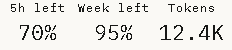

# Codex Sidekick

**A Stream Deck Neo companion for the OpenAI Codex extension in Visual Studio Code.** See your recent local Codex chats across projects on the Neo. Trusted hooks add live activity colors for Codex chats in every project. Open Codex, start a chat, or use native Codex dictation from the same page.

> **Unofficial.** Codex Sidekick is an independent open-source project. It is not affiliated with, endorsed by, or sponsored by OpenAI, Microsoft, or Elgato. Codex, OpenAI, Visual Studio Code, Stream Deck, and Elgato are trademarks of their respective owners.

**Requirements:** macOS 13 or later (released installers are built for Apple silicon; build from source on an Intel Mac), Stream Deck 7.6 or later with a Stream Deck Neo, VS Code with the official OpenAI Codex extension, and Node.js 22.18 or later for activity setup.

**Status:** early release. Dictation works by clicking Codex's own microphone button, so a Codex update can break it until Sidekick is updated. See [limitations](#limitations).

## What it looks like

<p align="center"></p>

The top row shows your four most recent Codex chats from any project, with a glow that follows what Codex is doing. The bottom row opens Codex, starts a chat, opens a Codex editor panel, and dictates. The Infobar shows how much of your Codex allowance is left and the tokens of the latest request:

<p align="center"></p>

*Images are rendered from the plugin's own drawing code (`npm run docs:images`).*

## Install

Download `codex-sidekick-neo-<version>.vsix` and `dev.sidekick.codex-<version>.streamDeckPlugin` from the project's Releases page, or build them yourself (see [Develop and verify](#develop-and-verify)).

Dictate finds the native Codex composer microphone through macOS Accessibility and clicks it. Codex handles recording, transcription, and inserting the draft.

## Set up

1. Double-click the `.streamDeckPlugin` file and confirm in Stream Deck. In VS Code, choose **Extensions → … → Install from VSIX…**, pick the `.vsix`, and reload the window.
2. Open a trusted local folder in VS Code. Sidekick connects it and installs its hooks into `~/.codex/hooks.json` automatically the first time. If you already have a hooks file, it is never overwritten; Sidekick offers a draft to merge instead. If a second VS Code window is already connected, run **Codex Sidekick: Toggle Connection for This Workspace** in the one you want, because two connected windows disable the keys.
3. In the Codex sidebar, open **Codex Settings → Hooks** and review and trust the eight Sidekick hooks. Then send a message in any chat; its key should glow.
4. Arrange the Neo: put **Chat Activity 1–4** on the top row, **Open Codex**, **New Chat**, **New Panel** and **Dictate** on the second, and drag **Codex Usage** onto the Infobar.
5. For dictation, enable **Elgato Stream Deck** in **System Settings → Privacy & Security → Accessibility**, and allow VS Code microphone access when macOS asks. Press **Dictate** to start recording and again to stop. The draft stays unsent in Codex.

Activity colors: blue pulse is recent work, amber is a recent approval request, a brief green glow is the end of a turn, and coral is an interruption. They fade as observations expire. Check Codex itself for current state and for approvals.

## Layout

| Path | What it is |
| --- | --- |
| `apps/vscode-extension/` | VS Code extension: command allowlist, workspace bridge socket, chat titles, hook setup |
| `apps/streamdeck-plugin/src/` | Stream Deck plugin: keys, artwork, Infobar, bridge client, dictation |
| `apps/streamdeck-plugin/native-helper/` | Swift helper that finds and clicks Codex's microphone, built into the plugin at package time |
| `apps/streamdeck-plugin/dev.sidekick.codex.sdPlugin/` | Plugin manifest, layout and assets. `plugin.mjs` and `native/` inside it are build output |
| `packages/` | Code shared by both sides: hook recorder, bridge protocol, account usage |
| `tests/`, `scripts/` | Automated suite, build and packaging scripts |

## Develop and verify

```sh
npm ci
npm test
npm run test:host
npm run package:vsix
npm run package:neo
```

The automated suite uses synthetic hook events and a simulated Stream Deck host. The VS Code smoke test opens a disposable profile and exercises the installed OpenAI extension. The source is MIT licensed.

The build clears the extension's `dist/` directory before bundling. Generated bundles and the native helper are excluded from source control; installers are written to `release/`, which is excluded from source control. Attach them to a GitHub Release. The VS Code installer includes only its manifest, README, license, extension bundle, and recorder.

Installer versions come from `apps/streamdeck-plugin/dev.sidekick.codex.sdPlugin/manifest.json` and `apps/vscode-extension/package.json`. Change them there only; the packaging scripts name the installers from those files. The stable VS Code extension ID is `codex-sidekick.codex-sidekick`. Its storage holds the hook recorder and per-folder connection settings. Treat `packages/hook-recorder/{record,events,metadata}.mts` as frozen unless the recorder really must change: the stored recorder is named after a hash of its built bytes, so any edit there, even removing an `export`, makes every user re-trust all eight hooks.

Packaging the Neo plugin compiles its small native helper with the macOS command line developer tools for the build Mac's architecture. It runs only for a key press and reads control labels and workspace window identifiers. It does not read chat text, source files, or audio. Dictation requires Stream Deck Accessibility access. The helper only clicks a microphone control inside a webview owned by the Codex extension, in the connected workspace's window, and returns the pointer afterwards. With two Codex composers on screen it prefers the focused one, then the sidebar, and it confirms from the control's own label that Codex started or stopped. UI automation can require updates when Codex changes its interface.

## Project site

`docs/index.html` is a self-contained landing page (no external requests) that GitHub Pages can serve. To publish it, open the repository's **Settings → Pages**, choose **Deploy from a branch**, then select your default branch and the `/docs` folder. Its GitHub and Download buttons point at your repository automatically when served from `owner.github.io/repo`.

## Limitations

- **macOS only.** Dictation uses macOS Accessibility, and the bridge uses a local Unix socket.
- **Dictation depends on Codex's interface.** It finds the microphone by its accessibility label, so a Codex redesign can break it until the helper is updated. The helper refuses to act when it cannot identify a single Codex microphone in the connected workspace's window.
- **Activity colors are observations, not live state.** They come from Codex hooks and expire after a short time. Approval decisions always stay in Codex.
- **One connected VS Code window at a time.** Two connected windows disable the keys.
- **Chat selection is limited by Codex.** Codex exposes no command for choosing a sidebar chat, so a chat key focuses the matching editor tab when one is open and otherwise opens the sidebar.

## Privacy and security

Everything runs locally. Hooks record only event names, timestamps, hashed session IDs, and token counts. See [SECURITY.md](SECURITY.md) for what is stored, what the native helper can and cannot do, and how to report a vulnerability.

## Contributing

Issues and pull requests are welcome. Add a test for behavior you change, keep prompts and file paths out of the activity log, and don't weaken the fail-closed checks in the command allowlist, recorder or native helper. The native helper's self-test covers decision logic only, so say in your pull request if you could not test dictation on hardware.

## License and credits

MIT, see [LICENSE](LICENSE). The Infobar text uses glyph data derived from IBM Plex Mono, licensed under the SIL Open Font License; see `apps/streamdeck-plugin/dev.sidekick.codex.sdPlugin/assets/fonts/OFL-IBM-Plex-Mono.txt`.
